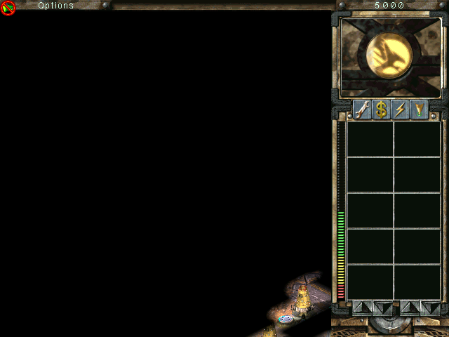

# Tiberian Sun — Disassembly to Source

A reverse-engineering project that takes the retail PC release of
**Command & Conquer: Tiberian Sun** (Westwood Studios, 1999) and reconstructs it
as compilable, documented C++ source — and executes the original program's own
instruction stream against a model of the x86 machine it was written for.

## Progress screenshot



*The model's own 640x480 render: the in-game tactical HUD plus a revealed area
of terrain, the GDI construction yard and a unit. The map reveals 1,124 cells
around the scenario's `HomeCell`, but the viewport draws that area at its
bottom-right corner instead of centring it; fixing the render offset is the
current work item. The main menu (`re/out/frame.png`), the GDI intro
(`re/out/mission.png`) and the loading screen (`re/out/render_2_6b.png`) are
committed alongside it.*

## Status

The reconstructed source **compiles, links and runs**. The binary is recovered,
its whole instruction stream is transcribed, the compiler confirms the recovered
memory layout at the target 32-bit ABI, and the original entry point executes
against the machine model.

It is **not yet a playable game**, and the source is not yet source-shaped.

**What runs today**

- The model maps the PE at its real VAs, resolves all 341 import-directory
  thunks, and reaches the game's own message loop with 0 unmapped calls.
- It decrypts the MIX archives with a real Blowfish-ECB implementation, reads the
  CD, builds its real LANGUAGE.DLL dialogs, and **renders the main menu** — a
  mean channel difference of 1.06/255 from the retail screenshot on the pixels
  that differ.
- The menu is selectable through the game's own hit-test. The campaign list comes
  from the shipped `BATTLE.INI`, the GDI mission loads `GDI1A.MAP`, the intro
  plays, and the game reaches the **in-game tactical HUD** with a populated
  world: 3 units, 17 infantry and 36 structures, plus 7 houses.
- The map reveals 1,124 cells around the scenario's `HomeCell` (cell 68,76), but
  the viewport draws that area at its bottom-right corner instead of centring
  it. That is the current blocker: the tactical camera origin/render offset, not
  the reveal pipeline and not the renderer.

**What is recovered**

| Measure | Value |
|---|---|
| functions recovered | 43,557 spans, 95.86% of `.text` |
| instruction stream transcribed | 45,947 functions, 912,879 instructions, 0 unmodelled |
| classes / vtable slots | 749 / 9,810, every slot bound through the binary's RTTI |
| member offsets | 4,289 recovered, 4,285 (99.9%) confirmed against the binary |
| verification | 9 fail-closed checks at `-m32`; 3,073/3,073 offsets compiler-confirmed; 492 TUs link and run |
| tests | 103 tool checks, 110 rendering/input checks, mutation-proven |
| interpreter | ~400M instructions/s |

Every function body is generated machine transcription, one instruction per line,
not the C++ the original authors wrote. The editable surface is the hand-written
headers.

## Verifying

```bash
cd re
./tools/pipeline.sh                            # regenerate everything, then verify
python3 tools/verify.py src/include build/shim # the 9-check gate
python3 tools/link_test.py                     # link 492 TUs and run the entry point
python3 tools/test_tools.py                    # tests the tools themselves
python3 tools/test_runtime.py                  # rendering/input tests
```

The gate is fail-closed, and only check 4, check 9 and
`verify_members_binary.py` are anchored in the binary rather than in another
tool's output. `VERIFICATION PASSED` means the tree compiles, links and matches
the recovered data — not that the disassembly is proven correct.

## Booting the original program

```bash
cd re
TS_CD=../work/cd1 python3 tools/boot.py          # model D: as a TS1 CD-ROM
python3 tools/boot.py --strict                   # exit non-zero on a garbage call target
```

`TS_ROOT` selects the host root for ordinary files; `TS_CD` maps `D:` to a host
directory as a `DRIVE_CDROM` labelled `TS1`, so the game can find `D:\TS1.dsk`
and its MIX files. `tools/wine_env.sh` runs the **retail** binary under Wine and
is the project's external oracle.

## Layout

```
re/
  bin/GAME.EXE        target binary (local copy; not tracked)
  tools/              recovery, generation, verification and boot tooling
  out/                recovered data and committed frames
  src/include/        reconstructed headers (generated; do not hand-edit)
  src/handwritten/    evidence-backed headers, including the machine model
  src/generated/      forwarders; src/generated/code/ is the transcription
realdata/             shipped INI files extracted from TIBSUN.MIX
todo.md               defect ledger and next work
```

## Method

The binary is stripped but retains complete MSVC 6 RTTI. Every declaration cites
its evidence: an RTTI descriptor address, a vtable address, a constructor
address, an INI key string, or a function address. Uncertainty is marked
explicitly (`/* ? */`, `vfunc_N`) rather than guessed at, and known gaps are
recorded rather than hidden.

Two rules from this project are worth repeating: a gate that has never failed is
not a gate, and a stub that returns a plausible wrong value is worse than one
that fails loudly.

## Working on this

Read [AGENTS.md](AGENTS.md) first — ground rules, toolchain and the technical
facts about the binary. [ROADMAP.md](re/ROADMAP.md) says what is left and in what
order; [todo.md](todo.md) is the defect ledger. A generator change can break the
tree in ways no single check owns, so run `./tools/pipeline.sh` before claiming
one works.

## Notes

Reconstruction and documentation produced with **deepseek4.1-flash-1017** in
Claude Code.

Tiberian Sun and its assets are © 1999 Electronic Arts / Westwood Studios. This
repository contains only reconstructed source and derived data; the original
Westwood binaries are **not** redistributed. Supply a local copy of `GAME.EXE`
at `re/bin/GAME.EXE` to run the pipeline.
